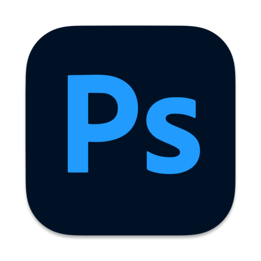

# Hi, I'm Vaibhav Velhal 👋

### MERN Stack Developer | Full-Stack Web Developer

I'm a developer from Maharashtra, India. I hold a B.Tech in Electronics and Telecommunication Engineering and have completed MERN Stack Development training at Mastercode Infotech, Pune.

I enjoy building responsive web applications and developing full-stack solutions using modern JavaScript technologies. I'm currently looking for opportunities as a **MERN Stack Developer / Full-Stack Developer** where I can contribute my skills and continue growing as a developer.

- 🔭 **Currently learning:** DevOps
- 🌱 **Core Stack:** React.js, Node.js, Express.js, MongoDB
- 🔐 **Interests:** REST APIs, authentication, database integration, and full-stack development
- 💼 **Looking for:** MERN Stack Developer / Full-Stack Developer opportunities
- 🌐 **Portfolio:** [Visit My Portfolio](https://vaibhav-velhal-portfolio.vercel.app)

---

### 🛠️ Technical Skills

**Frontend**

  
  
  
  
  
  

**Backend**

  
  
  

**Database**

  
  

**Tools & Deployment**

  
  
  
  
  

**Design Tools**

  
  

---

### 📊 GitHub Stats

  
  
  

---

### 📫 Connect With Me

- 🌐 **Portfolio:** [My Portfolio](https://vaibhav-velhal-portfolio.vercel.app)
- 💻 **GitHub:** [My GitHub](https://github.com/vaibhav-velhal)
- 💼 **LinkedIn:** [My LinkedIn](https://www.linkedin.com/in/vaibhav-velhal/)

I'm always interested in learning new technologies, building useful applications, and connecting with fellow developers. Thanks for visiting my profile! 😊
